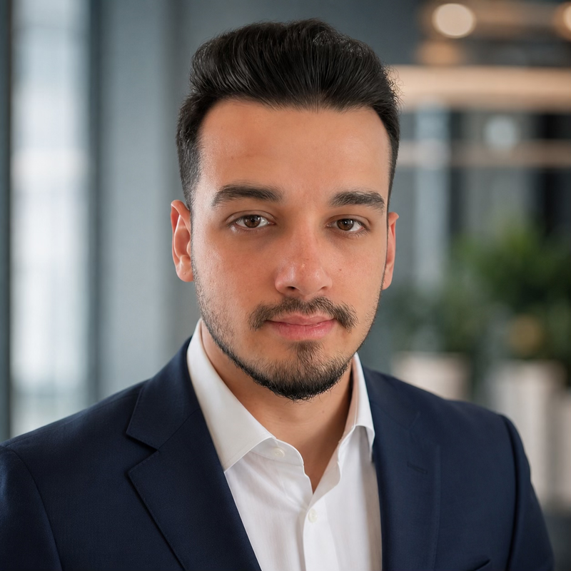

<div align="center">
  

  # Özkan Öztürk

  ### Software Developer · Mobile · Game · Web

  <a href="https://ozkandev.com"></a>
  <a href="mailto:13ozkanozturk@gmail.com"></a>
  

  <a href="./assets/cv/Ozkan_Ozturk_CV_EN.pdf?raw=1"></a>
  <a href="./assets/cv/Ozkan_Ozturk_CV_TR.pdf?raw=1"></a>
</div>

<br />

> I build dependable digital products across mobile, game, and web. My work combines practical product thinking with strong engineering fundamentals - from initial architecture to a polished production release.

## CV downloads

| Language | PDF |
| :-- | :-- |
| English | [Download / view English CV](./assets/cv/Ozkan_Ozturk_CV_EN.pdf?raw=1) |
| Türkçe | [Türkçe CV'yi indir / görüntüle](./assets/cv/Ozkan_Ozturk_CV_TR.pdf?raw=1) |

## About me

I am a software developer specializing in **Unity/C#**, **React Native**, and full-stack application development. I enjoy turning complex product requirements into scalable, maintainable experiences, whether that means a real-time sports platform, an educational game, or a responsive web application.

- End-to-end delivery: architecture, implementation, integrations, deployment, and iteration
- Strong focus on code quality, performance, scalability, and clear developer workflows
- Comfortable working independently or leading cross-functional development teams
- Using AI-assisted workflows thoughtfully to prototype, debug, refactor, and ship faster

## Core toolkit

<table>
  <tr>
    <td valign="top" width="33.33%">
      <h3>Mobile</h3>
      React Native<br />
      Expo · Bare Workflow<br />
      React Navigation · Redux<br />
      Context API · Native Modules
    </td>
    <td valign="top" width="33.33%">
      <h3>Games</h3>
      Unity 2D / 3D<br />
      C# scripting<br />
      Game physics · UI Toolkit<br />
      SDK &amp; asset integration
    </td>
    <td valign="top" width="33.33%">
      <h3>Web &amp; backend</h3>
      React · TypeScript<br />
      Tailwind CSS · REST APIs<br />
      Firebase · Supabase · MongoDB<br />
      GCP · VPS · SSL · deployment
    </td>
  </tr>
</table>

<p align="center">
  
  
  
  
  
  
  
  
</p>

## Selected experience

| Role | Product / company | Focus |
| :-- | :-- | :-- |
| **Software Developer** · Feb 2026 - Jul 2026 | **Out Urla** · Freelance | Built a React Native sports tracking and management product on Firebase, with real-time coach/student synchronization, lesson tracking, performance modules, and push notifications. |
| **Unity Team Lead** · Feb 2026 - Jul 2026 | **Project Olii / Kids AI** · Freelance | Led a five-person Unity team through architecture, implementation, testing, and release; owned game systems, backend integrations, and third-party SDKs. |
| **Software Developer** · Nov 2025 - Feb 2026 | **Sporsmaç / Adisebaba** | Delivered a mobile app end to end: TBF data pipelines, MongoDB and server infrastructure, Gemini-powered analysis, subscriptions, in-app purchases, and content filtering. |
| **Software Developer** · Sep 2023 - Jan 2026 | **Sevimli Dostlar / Adisebaba** | Developed and maintained Unity/C# applications with backend connections, external services, feature work, and performance improvements. |
| **Software Developer** · 2023 - 2025 | **Freelance web projects** | Shipped responsive, production web projects for Hasmed Sağlık, Apostle Paul's Ministry, Maison28, Mahal Edebiyat, and Devremülk Devre Tatil Mağdurları Derneği. |
| **Software Developer** · Nov 2020 - Sep 2023 | **RitimUs & njoyKidz** | Built educational and game applications in Unity/C#, contributing to gameplay, backend connectivity, debugging, and optimization. |

## What I bring to a product

```text
Product idea  →  Technical architecture  →  Implementation  →  Integration  →  Production release
                    mobile · web · game       APIs · SDKs         app stores · cloud · servers
```

**Production delivery** - Xcode, Android Studio, CocoaPods, TestFlight, App Store Connect, Google Play Console, Git/GitHub, VPS/server management, domains, SSL, and deployment processes.

**AI-assisted development** - I use tools such as Cursor and Antigravity to accelerate prototyping, implementation, debugging, refactoring, and technical decision-making while keeping code quality and maintainability at the center.

## Education & certificates

| Education | Institution | Years |
| :-- | :-- | :-- |
| Management Information Systems | Istanbul University | 2024 - present |
| Web Design and Coding | Anadolu University | 2020 - 2022 |
| Turkish Language and Literature | Istanbul University | 2016 - 2020 |

- Agile Project Management - Google
- Pedagogical Formation Certificate - Istanbul University
- Certificate of Teaching Turkish as a Foreign Language - Istanbul University

## Let's build something useful

I am open to software development opportunities and product collaborations across mobile, games, and web.

<p align="center">
  <a href="mailto:13ozkanozturk@gmail.com"><b>13ozkanozturk@gmail.com</b></a>
  &nbsp;·&nbsp;
  <a href="https://ozkandev.com"><b>ozkandev.com</b></a>
  &nbsp;·&nbsp;
  Istanbul, Türkiye
</p>
